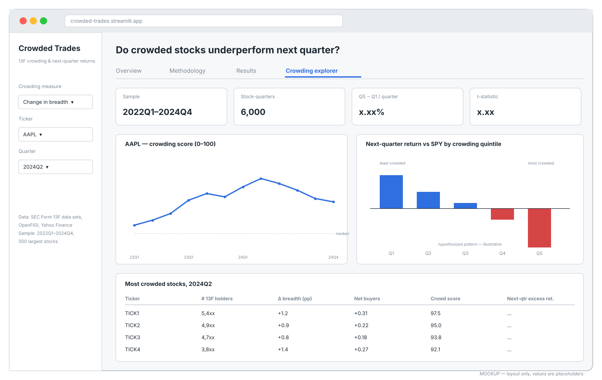

# Crowded Trades: What Happens When the Institutions Pile In?

**Harrison Babuschak · `[teammate]` · `[teammate]` · `[teammate]`**
FIN 331 Data Science for Finance · Lehigh University · Fall 2026

---

## Summary

Every quarter, U.S. investment managers with more than $100 million in equities disclose their stock holdings to the SEC on Form 13F. When a large number of managers move into the same stock at the same time, the position becomes **crowded**. Crowded positions can unwind violently: if those same managers need to sell together, there are few natural buyers.

We will measure crowding for the 500 largest U.S. stocks every quarter from 2022 through 2024, using the SEC's free structured 13F data. We then test whether crowding predicts the stock's return over the following quarter. We use only the information that was actually public on each date.

We will deliver a **public dashboard that shows a crowding score for any large U.S. stock over time**, alongside the evidence on whether that score has historically predicted returns.

## Who would pay for this

**A risk manager at a hedge fund or long-only asset manager.** Their portfolio managers are rewarded for good ideas, and good ideas tend to be shared. A risk manager needs to know which positions are also held by many other funds, and whether that overlap has historically signalled weaker returns or sharper drawdowns. Commercial crowding indicators exist and are expensive; our project asks whether a transparent version built from free public filings carries real information.

## Research question

> **Do stocks that many institutions bought last quarter earn lower returns over the next quarter?**

Two economic stories predict opposite answers, which is what makes the question worth testing:

| Story | Prediction for crowded stocks | Prior evidence |
|---|---|---|
| **Price pressure and reversal.** Herding pushes prices above fundamentals, and they fall back. | Lower next-quarter returns | Lakonishok, Shleifer & Vishny (1992); Sias (2004) |
| **Informed buying.** When many managers independently buy a stock, they collectively know something. Also, if short sellers are constrained, falling breadth signals overpricing. | Higher next-quarter returns | Chen, Hong & Stein (2002); Brown, Howard & Lundblad (2022) find positive average returns but larger crashes in market sell-offs |

**Our hypothesis (stated before seeing the full-sample results):** the most crowded quintile underperforms the least crowded quintile over the next quarter, after the market return. We treat a positive spread as an equally informative answer, not a failure.

## Data

### The observation

One row is **one stock × one 13F report quarter.** The key `(ticker, quarter)` is unique (checked with `assert`), and every merge is validated.

### Columns of the final dataset (`outputs/final_dataset.csv`)

| Column | Meaning |
|---|---|
| `quarter` | 13F report quarter (holdings as of quarter end) |
| `ticker`, `cusip`, `issuer` | Identifiers |
| `n_holders`, `n_holders_lag` | Number of 13F managers holding the stock this quarter and last quarter |
| `pct_chg_holders` | Percentage change in the number of holders |
| `dbreadth` | **Primary signal.** Change in ownership breadth: among managers that filed in both quarters, the change in the share holding the stock (percentage points) |
| `net_buyer_frac` | (Buyers − sellers) / (buyers + sellers) among those managers, with shares adjusted for splits |
| `crowd_score` | Dashboard score, 0–100: average of the within-quarter percentile ranks of `n_holders` and `dbreadth` |
| `filing_deadline`, `formation_date`, `holding_end_date` | Quarter end + 45 days; first trading day after it; next quarter's formation date |
| `ret_fwd`, `exret_fwd` | Return from formation date to holding end date; same minus SPY |
| `ret_past`, `vol_63d`, `log_inst_dollar` | Controls: prior-quarter return, 63-day volatility, log institutional dollar holdings |

### Example rows

> **Note for the team, delete before submitting:** replace this table with the real rows from `outputs/tables/sample_rows.md`. That file is written automatically when you run `CROWD_QUICK=1 python run_all.py`. The row below only shows the format.

| quarter | ticker | n_holders | n_holders_lag | dbreadth | net_buyer_frac | crowd_score | formation_date | ret_fwd | exret_fwd |
|---|---|---|---|---|---|---|---|---|---|
| 2023Q3 | *XXXX* | *…* | *…* | *…* | *…* | *…* | 2023-11-15 | *…* | *…* |

### Sample period

Signals for the 12 report quarters **2022Q1–2024Q4**. Holdings from 2021Q4 are used to measure the first quarter's change. Forward returns run through May 2025.

### Sample conditions

- **Stocks:** each quarter, the 500 largest U.S. common stocks by 13F-reported institutional dollar holdings. Only information available at that time is used: no "today's S&P 500" list, which would create survivorship bias. ETFs, ADRs, preferred shares and funds are excluded using OpenFIGI security types.
- **Managers:** original Form 13F-HR holdings or combination reports filed **on or before quarter end + 45 days**. Amendments and late filings are excluded, because they were not public at the signal date.
- **Positions:** common shares only. Option positions (`PUTCALL`) and principal-amount rows are excluded.

### Variables

| Absolutely necessary | Nice to have (stretch goals) |
|---|---|
| Manager × stock holdings (13F) | CRSP returns with delistings (removes the survivorship issue below) |
| Filing dates (for timing) | Market capitalization, book-to-market (better controls) |
| CUSIP → ticker map | Hedge-fund-only manager list (the seed's "hedge funds pile in") |
| Daily adjusted prices | Short interest (does crowding + shorting predict crashes?) |
| Market benchmark (SPY) | Longer sample, 2014–2026, including COVID |

### Raw inputs

| Input | Source | How we get it | Where it lives in the repo |
|---|---|---|---|
| Form 13F holdings | [SEC Form 13F data sets](https://www.sec.gov/data-research/sec-markets-data/form-13f-data-sets): free, tab-delimited, about 50–150 MB per zip | `src/01_download_13f.py` | `data/raw/sec_13f/` (git-ignored, re-downloadable) |
| CUSIP → ticker, security type | [OpenFIGI API](https://www.openfigi.com/api) | `src/03_universe_and_cusip_map.py`, cached | `data/raw/openfigi_cache.json` |
| Adjusted prices, splits | Yahoo Finance (`yfinance`) | `src/04_download_prices.py` | `data/raw/prices_daily.parquet` |

`data/raw/provenance.csv` logs the URL, pull time and SHA-256 hash of every raw input.

**One detail that shapes the design:** the SEC organizes its 13F files by *filing date*, not by report quarter. For example, the "2023 Q1" zip contains holdings *as of* December 2022. Our code reads every zip, then reassembles holdings by report quarter.

## Method

### Pipeline (one script per step, all run by `run_all.py`)

| Step | File | What it does |
|---|---|---|
| 1 | `src/01_download_13f.py` | Downloads only the SEC zips whose filing window we need |
| 2 | `src/02_parse_13f.py` | Keeps on-time original filings, one per manager-quarter. Builds the manager × stock × quarter holdings panel. Converts the $000s → $ value change (Jan 2023) |
| 3 | `src/03_universe_and_cusip_map.py` | Holder counts per stock. CUSIP → ticker via OpenFIGI. Top-500 universe per quarter |
| 4 | `src/04_download_prices.py` | Adjusted prices and split events for the universe and SPY |
| 5 | `src/05_build_dataset.py` | Crowding measures, formation dates, forward and control returns. Writes the final dataset |
| 6 | `src/06_analysis.py` | Sorts, regressions, cost-adjusted magnitudes, figures, specification log |
| 7 | `src/07_hand_checks.py` | Re-computes one number per step from the raw files with independent code |

### Timing: no look-ahead

```
 quarter end q          deadline (q end + 45 days)     next deadline
      |------------------------|*-----------------------------|*
      holdings measured        formation_date: buy at close   holding_end_date
      (NOT public yet)         (first trading day after)      ret_fwd measured over this window
```

A 13F describes holdings on the last day of the quarter, but the public sees it up to 45 days later. Every return in our tests starts **after** the filing deadline. To show why this matters, we also run the main test with the wrong timing (returns starting at quarter end) and report both in `outputs/tables/lookahead_comparison.csv`.

### Analysis

1. **Quintile sorts.** Each quarter, sort stocks into five groups by each crowding measure. Average the next-quarter return minus SPY in each group. The long–short spread is quintile 5 (most crowded) minus quintile 1. We report its mean, its t-statistic across quarters and the share of quarters it is positive.
2. **Fama–MacBeth regressions.** Each quarter, regress next-quarter excess return on the crowding measure plus controls for past return, volatility and size. All variables are standardized within the quarter, so each coefficient reads as "return per one standard deviation." We average the coefficients across quarters.
3. **Pooled OLS** with quarter fixed effects and standard errors clustered by stock, as a robustness check.
4. **Economic magnitude.** We turn the spread into a strategy and subtract trading costs: quintile turnover × 10 bp per side. Is the gross spread large enough to matter to a risk manager after costs?

**Why this fits the question.** Sorts show the shape of the relationship in a way a non-specialist can read off a bar chart. Fama–MacBeth asks whether crowding adds information beyond the obvious characteristics that are correlated with it, such as momentum and size. Both methods come from the asset-pricing anomaly tests used in class.

**Guarding against p-hacking.** `dbreadth` is the pre-registered primary signal. The other three measures are reported in full, not cherry-picked. `06_analysis.py` writes every specification it runs to `outputs/tables/specs_run.csv`, and `specs_tried.md` logs every other change by hand.

## Threats and checks

| How an auditor could break the project | What we do |
|---|---|
| **Look-ahead:** using quarter-end dates instead of filing dates | Returns start the first trading day after quarter end + 45 days. Late filings and amendments are dropped. An `assert` checks that formation follows the deadline. We report the wrong-timing result side by side |
| **CUSIP → ticker mapping errors** | OpenFIGI with a preference for the U.S. composite listing of common stock. Every 13F name vs. OpenFIGI name mismatch is written to `cusip_name_mismatches.csv` and reviewed by hand. CUSIPs that collide on one ticker keep the larger holding |
| **Survivorship:** Yahoo drops delisted tickers | The universe is built point-in-time from 13F, not from today's index. The share of stock-quarters missing a return is reported in `return_coverage.csv` and disclosed. CRSP is the fix if we gain access |
| **Size of the 13F files** | Zips are git-ignored and re-downloaded. Information tables are read in 1-million-row chunks and filtered immediately. Holdings are stored per quarter as Parquet |
| **13F unit change and filer errors** | $000s → $ conversion by filing date (2023-01-03). The size ranking uses the median implied price across filers, so a few mis-reporting filers can't move it |
| **Stock splits** fake "buying" | Last quarter's shares are multiplied by the Yahoo split factor between the two quarter ends before buyers and sellers are counted |
| **Broken merges / duplicate keys** | Every merge uses `validate=`. Keys are asserted unique at every stage |
| **Numbers that don't trace** | The dashboard reads only `outputs/`. Headline numbers come from `outputs/tables/headline_numbers.json` |
| **Hand checks** | `07_hand_checks.py` re-counts one stock's holders straight from the raw zips, recomputes one return from raw prices, re-derives one formation date, and re-sorts one quarter by hand. Any mismatch stops `run_all.py` |
| **Short sample (12 quarters)** | We emphasise magnitudes and hit rates, report every specification, and propose extending to 2014–2026 |

## Dashboard

The dashboard is a Streamlit app (`app.py`) with four tabs:

- **Overview:** the question and headline numbers
- **Methodology:** the pipeline and timing rules, plus how many filings each rule removed
- **Results:** quintile bar chart, long–short table, look-ahead comparison, regressions and costs
- **Crowding explorer:** pick any ticker to see its crowding score and holder count over time, or pick a quarter to see the most crowded stocks



*Mockup. The layout is final; the values shown are placeholders.*

## Timeline

| Date | Deliverable |
|---|---|
| Sat Nov 14 | **v0:** pipeline on the 2023 sample (`CROWD_QUICK=1`), dashboard skeleton, this proposal, self-audit |
| Sat Nov 21 | **v1:** full 2022–2024 sample, results in the dashboard, response to the AI audit |
| Dec 1 / Dec 3 | Presentation; final repo |

## References

- Brown, G. W., P. Howard, and C. T. Lundblad (2022). Crowded trades and tail risk. *Review of Financial Studies* 35(7), 3231–3271.
- Chen, J., H. Hong, and J. C. Stein (2002). Breadth of ownership and stock returns. *Journal of Financial Economics* 66, 171–205.
- Lakonishok, J., A. Shleifer, and R. W. Vishny (1992). The impact of institutional trading on stock prices. *Journal of Financial Economics* 32, 23–43.
- Sias, R. W. (2004). Institutional herding. *Review of Financial Studies* 17, 165–206.
- U.S. Securities and Exchange Commission. *Form 13F Data Sets* and *Form 13F Data Sets readme* (`form_13f_readme.pdf`).
